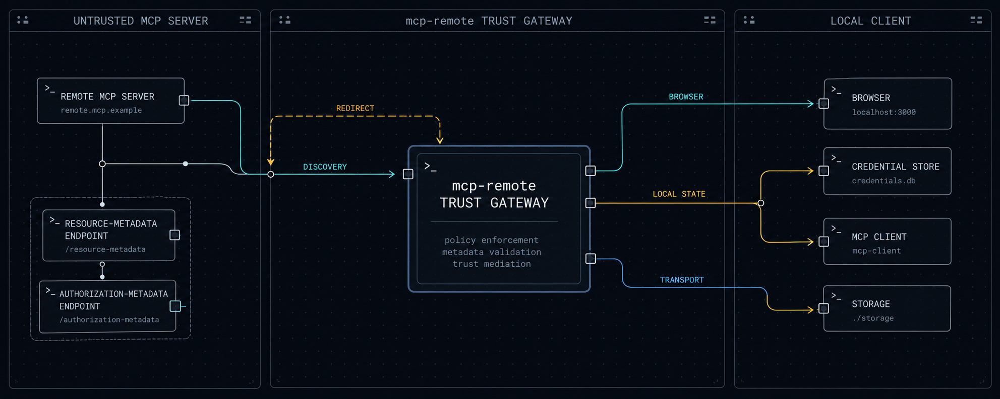

  

<h1 align="center">mcp-remote OAuth Trust-Boundary Security Advisories</h1>

  <strong>Five published CVE records, all scored by CISA-ADP, up to 9.8 Critical. 
  The current published CLI, <code>0.15.1</code> of 14 October 2026, still follows the server-selected request paths of CVE-2026-51994 and CVE-2026-51995.</strong>

  
  
  
  
  

  <a href="docs/research-2026-10-09/RESEARCH_DOSSIER.md">Research dossier, 9 October 2026</a> ·
  <a href="docs/research-2026-10-15/README.md">0.15.1 follow-up, 15 October 2026</a> ·
  <a href="#advisory-index">Advisory index</a> ·
  <a href="https://playb0t.com">Impact ledger</a>

## Executive summary

`mcp-remote` bridges stdio-only MCP clients to remote MCP servers and runs OAuth discovery on their behalf. That makes remote-server metadata a security boundary: a server-selected URL, redirect or credential destination must not become trusted because it appeared during discovery.

Seven advisories document the review of the release current at disclosure, `0.1.38`: two localhost-canary reproductions, three bounded source reviews, two hardening records corrected in `v1.0.1`. The private report went to the maintainer on 17 February 2026; the public disclosure followed on 31 July after no acknowledgement; MITRE published five CVE records on 24 September 2026, and CISA-ADP scored all five. On 9 October 2026 the published `0.14.3` CLI, run in full in three local stdio scenarios, reproduced the F-01 / F-02 request path, HTTP 302 redirect included, and the discovery helpers executed in all 58 stable releases from `0.1.32` to `0.14.3`. Between the private report and 7 October 2026 npm served 19,060,907 downloads of the package. No fixed release has been stated. On 14 October 2026 the maintainer published four releases, `0.14.4` through `0.15.1`; none of them names a record. On 15 October the 9 October procedure was repeated on `0.15.1`. It recorded the same F-01 / F-02 request paths. In the full trace it also recorded a token request, carrying an Authorization header, to the authorization server named by the server's own metadata, as it does in `0.14.3` runs under the same environment.

[Methodology](METHODOLOGY.md) · [Disclosure timeline](TIMELINE.md) · [Corrections](CORRECTIONS.md) · [Trust-boundary map](assets/mcp-remote-trust-boundary-map.png)

## Advisory index

The `F-*` identifiers are stable research IDs. Ranges are those of the original advisories; scores are the published **CISA-ADP CVSS 3.1** assessments, reported as published. The research asserts no numeric score of its own, and its evidence classes stay separate from the official severity.

| Advisory | CVE record | CISA-ADP | Relevant versions | Evidence |
|---|---|---|---|---|
| [F-01 · SSRF via unvalidated `resource_metadata` URL](advisories/F-01-resource-metadata-ssrf.md) | [CVE-2026-51994](https://www.cve.org/CVERecord?id=CVE-2026-51994) | 9.1 Critical | `0.1.32–0.1.38` | Local PoC, reverified |
| [F-02 · Blind SSRF via `authorization_servers[]`](advisories/F-02-authorization-server-ssrf.md) | [CVE-2026-51995](https://www.cve.org/CVERecord?id=CVE-2026-51995) | 7.5 High | `0.1.32–0.1.38` | Local PoC, reverified |
| [F-04 · MD5-based storage namespace hardening](advisories/F-04-md5-token-isolation.md) | [CVE-2026-51996](https://www.cve.org/CVERecord?id=CVE-2026-51996) | 9.8 Critical | `0.0.14–0.1.38` | Defense-in-depth / corrected |
| [F-08 · Internal-address validation before browser launch](advisories/F-08-browser-url-validation.md) | [CVE-2026-51997](https://www.cve.org/CVERecord?id=CVE-2026-51997) | 8.8 High | `0.1.16–0.1.38` | Source review |
| [F-09 · OAuth credentials stored in cleartext](advisories/F-09-cleartext-token-storage.md) | — | — | `0.0.11–0.1.38` | Source review |
| [F-10 · Redirect following bypasses one-time URL validation](advisories/F-10-redirect-validation-bypass.md) | — | — | `0.1.32–0.1.38` | Source review |
| [F-11 · Explicit token-origin binding as transport hardening](advisories/F-11-sse-token-origin-scope.md) | [CVE-2026-52001](https://www.cve.org/CVERecord?id=CVE-2026-52001) | 7.5 High | `0.0.18–0.1.38` | Defense-in-depth / corrected |

Each advisory names its CVE record in its Classification block. F-09 and F-10 carry no public record; two further identifiers, CVE-2026-51998 and CVE-2026-51999, remain RESERVED.

<!-- research-2026-10-09 -->
## Research update: 9 October 2026

Researcher: Alex Gercog (playb0t). The [research dossier](docs/research-2026-10-09/RESEARCH_DOSSIER.md) adds three results:

- **Published CLI 0.14.3.** The unchanged CLI completed three local stdio scenarios with 43 HTTP events, a controlled HTTP 302 redirect included: it followed the server-selected `resource_metadata` destination of [F-01](advisories/F-01-resource-metadata-ssrf.md) (CVE-2026-51994) and made the subsequent authorization-server metadata request of [F-02](advisories/F-02-authorization-server-ssrf.md) (CVE-2026-51995). The fixture used `http-only` transport, `client-credentials` mode and synthetic static client information; a real OAuth login and desktop UI were not tested.
- **Release history.** Selected first-party discovery helpers were traced and executed across 58 stable releases, `0.1.32` through `0.14.3`, in 74 integrity-checked archives, recording 290 local HTTP events. The file entered upstream in commit `d20f5958`, published as `0.1.32` on 17 December 2025.
- **Code distribution.** The [distribution map](docs/research-2026-10-09/CODE_DISTRIBUTION.md) records selected code and namespace signatures under 12 other npm names (8 with reference-function matches, 4 namespace-only) and in 8 other Git repositories, inside bundles above the 350 KiB indexing limit of GitHub code search. The [download snapshot](docs/research-2026-10-09/DOWNLOAD_SNAPSHOT_AND_CODE_FOOTPRINT.md) records 19,060,907 npm downloads between 17 February and 7 October 2026.

The selected metadata path is classified as CWE-918 / Missing Defense. These runs establish the recorded request behavior under the stated fixture conditions; they do not by themselves establish disclosure of sensitive information or change the published CVE ranges, and they identify no fixed release.

[Evidence and accounting](docs/research-2026-10-09/EVIDENCE.md) · [Recorded procedures](docs/research-2026-10-09/REPRODUCIBILITY.md) · [Data and checksums](docs/research-2026-10-09/README.md)
<!-- /research-2026-10-09 -->

<!-- research-2026-10-15 -->
## Research update: 15 October 2026

Researcher: Alex Gercog (playb0t). The [0.15.1 follow-up](docs/research-2026-10-15/README.md) repeats the 9 October procedure on the release published the day before.

- **Upstream moved.** On 14 October 2026 the maintainer published `0.14.4`, `0.14.5`, `0.15.0` and `0.15.1` between 18:27 and 22:36 UTC. They are the first releases since `0.14.3` of 21 September. They carry five contributor pull requests and one commit of his own, all on the OAuth callback, the coordination and the credential store. One of them fixes a callback XSS reported by another researcher. No release note, commit or pull request names any of the five records. No fixed release is stated.
- **Published CLI 0.15.1.** The unchanged 9 October procedure ran on the SRI-verified `0.15.1` package. It gave the same three scenario snapshots as `0.14.3`: 43 HTTP events, 15 canary events, a controlled HTTP 302 followed. The client fetched the server-selected `resource_metadata` destination of [F-01](advisories/F-01-resource-metadata-ssrf.md) (CVE-2026-51994) and made the authorization-server metadata request of [F-02](advisories/F-02-authorization-server-ssrf.md) (CVE-2026-51995). The full trace of the run also holds a `POST /token` carrying an `Authorization` header to the loopback canary, the authorization server the server's metadata named. The same event appears in `0.14.3` runs; it sits outside the 9 October snapshot. Twelve runs across the five versions are kept. Three of them were stopped by the procedure's own no-Authorization assertion.
- **Code and SDK.** The ten helper functions behind the five records are byte-identical between `0.14.3` and `0.15.1`. The 24 helper-level checks pass. The bundle still carries `@modelcontextprotocol/client` 2.0.0. The issuer-binding change of client 2.2.0 and the redirect policy of client 2.3.0 are absent from it.

F-08 is confirmed in source only, F-11 in source plus the executed endpoint listener; neither by a full run. A third distinct origin in the redirect chain was not measured. The follow-up establishes that these request paths are present in `0.15.1` under the stated fixture. It does not extend any official affected range, and it identifies no fixed release.

[Follow-up report, data and checksums](docs/research-2026-10-15/README.md)
<!-- /research-2026-10-15 -->

## Registries and pickup

<strong>Registry status, 7 October 2026</strong> — a dated snapshot, kept as history

- **CVE records.** Five records published by MITRE as the CNA on 2026-09-24: CVE-2026-51994 (F-01), CVE-2026-51995 (F-02), CVE-2026-51996 (F-04), CVE-2026-51997 (F-08) and CVE-2026-52001 (F-11). Two further identifiers reserved for this request remain unpublished.
- **CISA-ADP CVSS 3.1.** CVE-2026-51996 9.8 Critical (added 2026-09-29), CVE-2026-51994 9.1 Critical, CVE-2026-51997 8.8 High (user interaction required), CVE-2026-51995 7.5 High, CVE-2026-52001 7.5 High (added 2026-10-06). The values are reported as published.
- **NVD.** All five records are in status Deferred; NVD displays CISA's metrics as secondary and holds none of its own.
- **GitHub Advisory Database.** The five records appear as unreviewed entries without a package mapping, so Dependabot does not alert on them; the only reviewed advisory mapped to the npm package `mcp-remote` is CVE-2025-6514 (2025-07-09).
- **OSV.** OSV derives version ranges from the description text and lists `0.1.38` as fixed; the commit it names as the fix is the `0.1.38` release itself, and the records include `0.1.38`. The records' structured `affected` field reads `n/a`; a request to populate it with the ranges from the descriptions was sent to the CNA on 30 September 2026.
- **CISA KEV.** None of the five records is listed in the Known Exploited Vulnerabilities catalog as of 2026-10-04 (catalog of 1,734 entries); CISA's SSVC on all five records reads exploitation: none.

Picked up: [agent-audit-kit v0.6.18](https://github.com/sattyamjjain/agent-audit-kit/releases/tag/v0.6.18) added CVE-2026-52001 to its mcp-remote rule within eight hours of the issue and credited the report. [UltraRAG](https://github.com/OpenBMB/UltraRAG/pull/538) fixed the remote-MCP launch reported in issue #537 within 27 hours and credited the report; the fixed path starts an unpinned `npx -y mcp-remote`, and [issue #541](https://github.com/OpenBMB/UltraRAG/issues/541) put the five records to the project the same day. [Supabase](https://github.com/supabase/supabase/pull/51646) merged the pull request that moves its Devin preset off the bridge to the client's native HTTP path, seven hours from opening to merge; the records went to the thread after the merge.

## Responsible-disclosure summary

The private advisory was submitted on 17 February 2026 and the findings revalidated on 3 May 2026 after no maintainer response or new release; the reviewed and revalidated commit is `02619aff36e79803d7c894e8c8ae7b34b2d11f8c` (`0.1.38`). Public disclosure on 31 July 2026 followed an extended coordination period. Since disclosure, releases `0.1.39` (21 August 2026) through `0.15.1` (14 October 2026) were published from `punkpeye/mcp-remote`, where the repository moved; the CVE records name it `geelen mcp-remote`, and the `geelen` URLs redirect. The earlier [CVE-2025-6514](https://nvd.nist.gov/vuln/detail/CVE-2025-6514) fixed command injection in the browser-launch path in `0.1.16`; this repository documents the adjacent trust-boundary findings.

[Full timeline](TIMELINE.md) · [Scope and version corrections](CORRECTIONS.md) · [Publication corrections and upstream routing](SECURITY.md)

## Use and citation

Discovered and reported by **Alex Gercog ([playb0t](https://github.com/playb0t))**. Defenders, maintainers and vulnerability databases may cite the stable advisory URLs in this repository; when citing a finding, preserve its ID, version range, evidence class and limitations. Machine-readable citation metadata: [`CITATION.cff`](CITATION.cff).

Articles: [Five mcp-remote CVE records, five CISA scores, no stated fix](docs/article-2026-10-08.md) (8 October 2026, second edition) · [The Server Named the URL, the Client Went](docs/article-2026-09-30.md) (30 September 2026, first edition).
